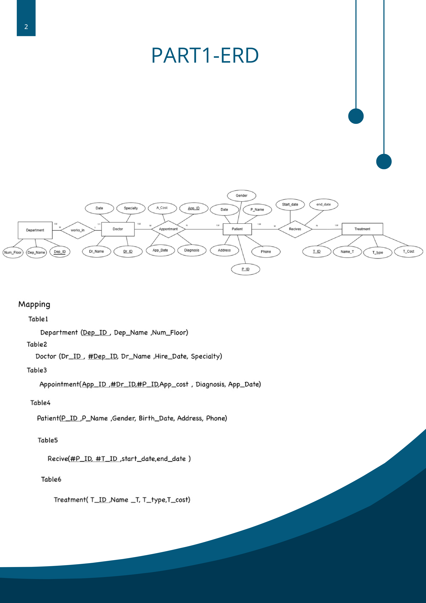

# Hospital Management Database System

## Project Overview
This project is a hospital management database system developed as part of a Database Systems course. It organizes hospital information, including departments, doctors, patients, appointments, and treatments.

## Objectives
- Design a relational database using an Entity-Relationship Diagram (ERD).
- Create tables and define primary and foreign key constraints.
- Insert sample data into the database.
- Retrieve and analyze data using SQL queries.
- Implement PL/SQL blocks, stored procedures, and functions.

## Database Tables
The database consists of six tables:

- **Department:** Stores hospital department information.
- **Doctor:** Stores doctors' information and department assignments.
- **Patient:** Stores patient information.
- **Appointment:** Stores appointment dates, diagnoses, and costs.
- **Treatment:** Stores treatment names, types, and costs.
- **Receive:** Records treatments received by patients and their dates.

## Technologies Used
- Oracle SQL
- PL/SQL
- Relational Database Design
- Relational Algebra

## Project Files
- `schema.sql` — Creates the database tables and relationships.
- `insert_data.sql` — Inserts sample data into the tables.
- `queries.sql` — Contains SQL queries for retrieving and analyzing data.
- `plsql.sql` — Contains PL/SQL blocks, a stored procedure, and a function.

## How to Run
1. Set up an Oracle Database environment or an Oracle APEX workspace.
2. Run `schema.sql` first to create the tables.
3. Run `insert_data.sql` to insert the sample data.
4. Run `queries.sql` to execute the database queries.
5. Run `plsql.sql` to create and test the PL/SQL code.

**Note:** Run the scripts in the order listed above. The SQL files are provided for review and execution in an Oracle-compatible environment.

## Project Type
Academic Database Systems Project

## Entity-Relationship Diagram (ERD)
